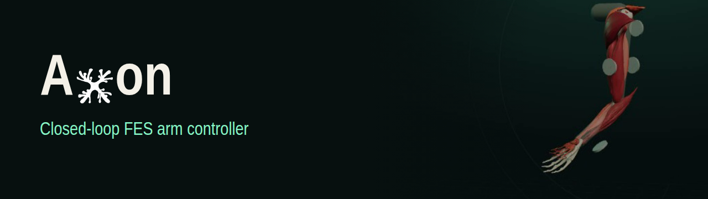
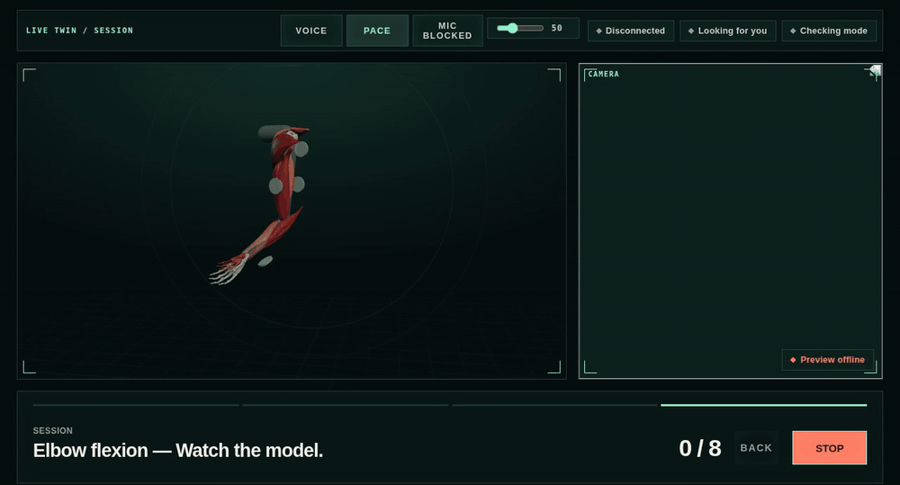
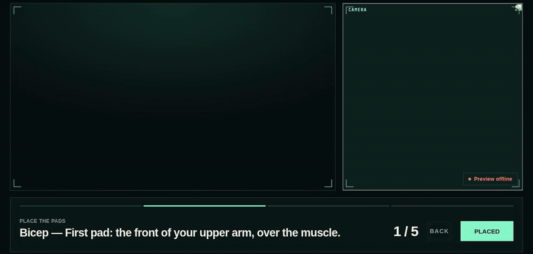
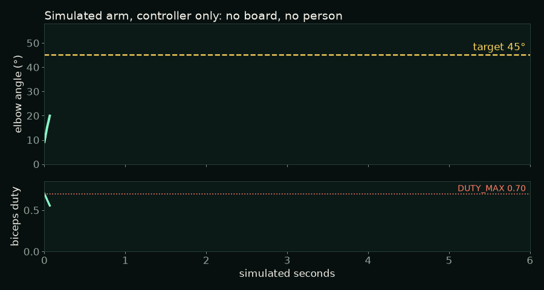
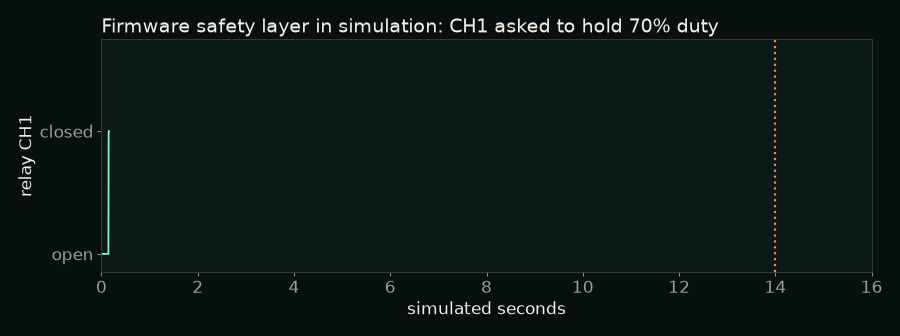
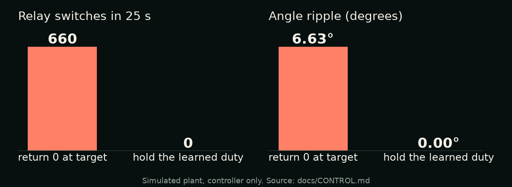
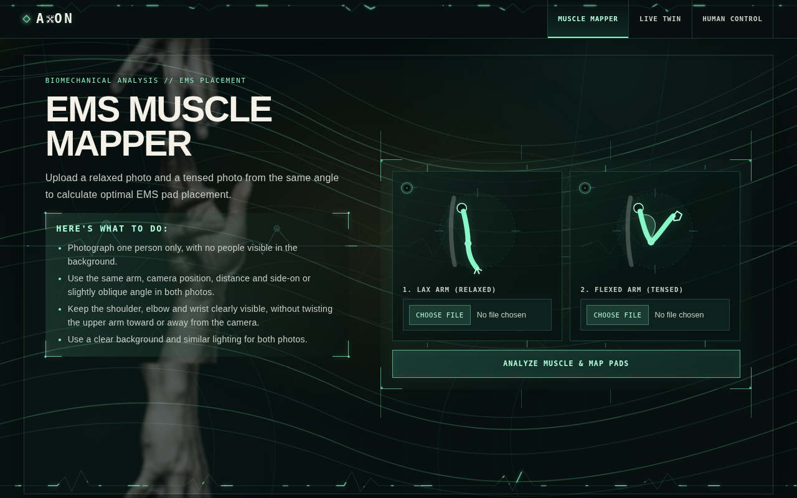
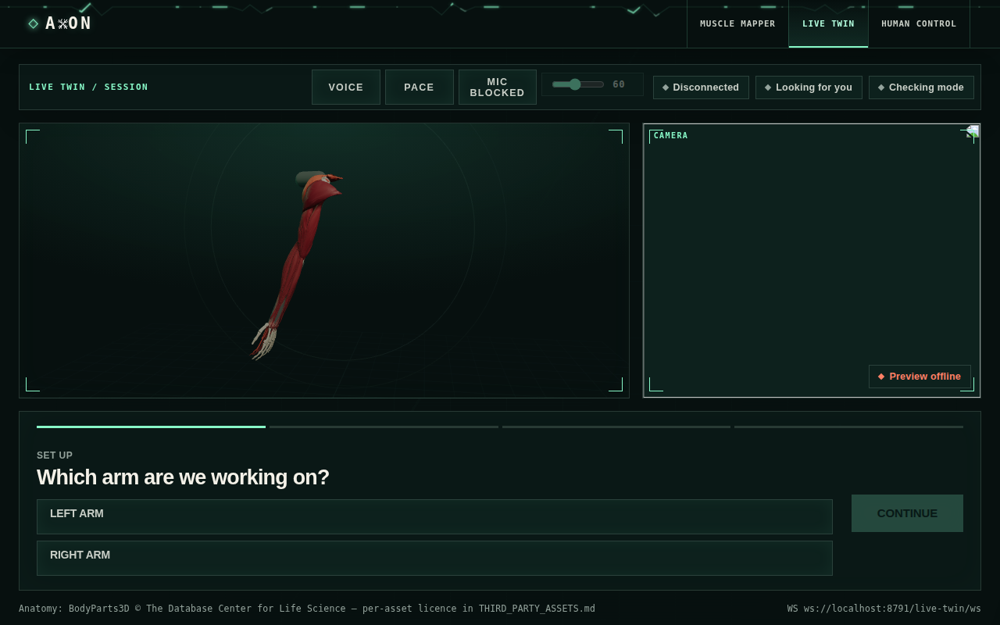
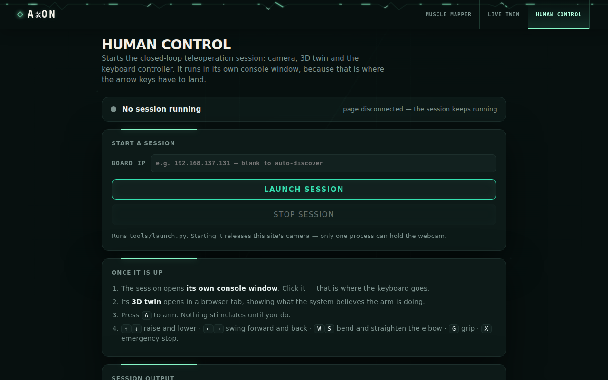

# Axon

[](docs/SAFETY.md)
[](controller/test_simulation.py)
[](firmware/)

> **This drives current through a person.** Read [`docs/SAFETY.md`](docs/SAFETY.md)
> before connecting anything to anybody. The safety limits are enforced on the
> microcontroller, deliberately independent of the control software.

A muscle driven by a timed stimulation sequence does not know where the limb went. Axon teleoperates a human arm with surface functional electrical stimulation (FES) under closed-loop control from an external pose estimate. An operator presses arrow keys; a PI controller compares the commanded joint angles against the arm's measured pose and gates the stimulation channels until the real limb matches. In the simulated arm, holding a pose for 25 seconds takes **0 relay switches, against 660** for a controller that returns zero at its target.

There is no intent detection, EMG or BCI: targets come from the keyboard, the voice coach or a scripted exercise. Grip is a gross power grasp, and pose comes from one webcam. It is a demonstrator, not a medical device.

## Demo



<sub>The Live Twin web app running locally, playing its own scripted elbow demonstration. No camera, no board and no person: the preview pane is offline. Anatomy: BodyParts3D, © The Database Center for Life Science, CC BY-SA 2.1 Japan, shown here cropped and posed.</sub>

## How it works

The PC decides *what the arm should do*. The ESP32 decides *what is physically allowed*.

1. **Place the pads.** The guided session shows where each electrode goes on a 3D anatomical arm. Seven muscles are driven over eight channels, and channel 6 is spare. (`webapp_demo/live_twin/`)

   

   <sub>The real pad steps at twice speed, with no hardware attached.</sub>

2. **Measure the arm.** A webcam feeds MediaPipe, which turns 3D landmarks into joint angles and sends them over UDP. Nothing in that path knows what the arm was told to do, only where it is. (`axon-main/`)

3. **Close the loop.** A PI controller runs at 30 Hz and turns the angle error into a duty for each channel. Inside its 3° deadband it stops correcting and holds the duty it has learned. (`controller/control_loop.py`, `controller/pid.py`)

   

   <sub>Simulation: the repo's controller driving its own simulated arm to 45°. It settles at 42.1°, inside the 3° deadband.</sub>

4. **Limit it on the board.** The firmware clamps duty at 0.70, allows at most 4 s of stimulation before a forced 2 s rest, and opens the relays when commands stop for 500 ms. The limit applies to held poses too, so the arm sags during the rest, and that is intended. (`firmware/lib/safety.py`, `firmware/config/settings.py`)

   

   <sub>Simulation: the repo's firmware code on a simulated clock, with no board or relays. Commands stop at 14 s.</sub>

## Results



Holding a limb up needs a constant muscle torque. Returning zero at the target drops the arm, which fires the controller again, and the cycle repeats; keeping the learned duty ends it. That comparison is the controller on a simulated plant and leaves out the board's 4 s / 2 s limit. Run `controller/test_simulation.py` to repeat the offline checks; the full tables are in [`docs/CONTROL.md`](docs/CONTROL.md).

| Result | Value | Evidence |
|---|---|---|
| Relay switches in a 25 s hold | 660 returning zero, **0** holding the duty | SIMULATED |
| Ripple in the same hold | 6.63° returning zero, **0.00°** holding the duty | SIMULATED |
| Elbow pose noise, one posture held still, 553 samples | 2.51° raw, **1.06°** filtered with 181 ms step lag | MEASURED |
| Offline checks | 151 | repeatable without hardware |

The 1.06° row was measured with a median-5 one-euro filter; the current setting is median-9, with 292 ms of lag. Camera setup dominates: repeated captures on one rig gave elbow noise from 2.5° to 10.9° with no code change.

## Screens

| Muscle Mapper | Live Twin | Human Control |
|---|---|---|
|  |  |  |

## Installation

The first two commands need only Python and no hardware, and the third needs a webcam and uv; run them from the repository root.

```bash
python controller/test_simulation.py      # 151 offline checks
python controller/run.py --sim            # virtual arm, drive it with the keyboard
python tools/launch.py --no-board         # real webcam pose, nothing stimulated
```

Pose tracking needs the packages described in [`axon-main/`](axon-main/README.md). The web app manages its own environment with [uv](https://docs.astral.sh/uv/) and Python 3.14: in `webapp_demo/`, copy `.env.example` to `.env`, fill in the keys, run `uv run uvicorn main:app --reload` and open port 8000. Pad firing from it is off by default, because a misheard command should not be able to stimulate anyone. Only one process may hold the webcam.

To use real hardware, read [`docs/SAFETY.md`](docs/SAFETY.md), then follow [`docs/DEPLOY.md`](docs/DEPLOY.md) to flash, [`docs/WIRING.md`](docs/WIRING.md) to wire and [`docs/TESTING.md`](docs/TESTING.md) to bench-test every channel before a closed-loop run. Stop a session with `Q` in its terminal: closing the browser does nothing, because the twin is only a viewer.

<details>
<summary><strong>Controls and status line</strong></summary>

One axis per key pair, each driving exactly one muscle pair:

| Key | Action | Muscle |
|---|---|---|
| `A` | **arm** — stimulation enabled (nothing moves until you press this) | — |
| `↑` | raise the arm (0–90°) | CH5 **middle** deltoid |
| `↓` | lower the arm | none — **gravity**, so it only works if already raised |
| `←` | swing **forward** | CH3 **anterior** deltoid |
| `→` | swing **back** | CH4 **posterior** deltoid |
| `W` | bend the elbow | CH1 biceps |
| `S` | straighten the elbow | CH2 triceps |
| `G` | **toggle grip** open/closed — it is `G`, **not Shift** | CH7 finger flexors |
| `D` | disarm | — |
| `X` | **EMERGENCY STOP** (latched; `A` to re-arm) | — |
| `?` | show the key list again | — |
| `Q` | quit (disarms on exit) | — |

Grip is `G` because a terminal cannot detect a bare Shift press or a key
release, so "hold to grip" is not implementable here. `G` toggles instead.

Boot state is **disarmed**. Nothing stimulates until you press `A`.

**Reading the status line**

```
[ARM] bd:ok pose:OK e45/60 f10/30 a0/15 g:- CH1:0.70 CH3:0.48
```

Compact so it fits any terminal width; on a narrow window the least useful
fields drop first, so state and board flags stay visible.

| Field | Meaning |
|---|---|
| `[ARM]` / `[DIS]` / `[KIL]` | armed / disarmed / e-stopped |
| `bd:ok` | what the **board** reports about itself (see below) |
| `pose:OK` / `pose:STALE` / `SIM` | pose estimator feed |
| `e45/60` | elbow: **actual 45°, target 60°**. `f` = forward-back (+ is forward), `a` = elevation (how high the arm is) |
| `g:C` / `g:-` | grip closed / open |
| `noise:e4` | **only appears when the pose feed has degraded** — measured noise now exceeds that joint's deadband, so the arm will hunt around its target rather than sit on it. Check the camera, not the gains. |
| `CH1:0.70` | channels firing and duty. `idle` = nothing stimulating |

The controller stimulates until **actual** catches up to **target**; arrow keys
move the target.

**If nothing moves,** the state and `bd:` flags say why:

| Shows | Meaning |
|---|---|
| `[DIS]` | not armed — press `A` |
| `[KIL]` | e-stop latched — press `A` to re-arm |
| `pose:STALE` | no pose data. Use `--sim` for a virtual arm |
| `bd:LOST3s` | no heartbeat — Wi-Fi dropped or board off |
| `bd:REBOOTED` | the board restarted — press `A` to re-arm |
| `bd:NO-REPLY` | never heard from it — wrong IP or firewall |

Two more reasons a key can look dead — both are announced on screen:

- **At a joint limit.** `←` at abduction 0° cannot go lower, so `tgt` does not
  move. You will see *"shoulder_abd is already at its limit"*.
- **Inside the deadband.** Each arrow press is 3°, but the controller ignores
  errors under the **3° deadband** — that is what stops the arm buzzing at the
  setpoint. **Press an arrow twice before expecting movement.**

</details>

## Documentation

[`docs/README.md`](docs/README.md) is the index. Start with [`docs/SAFETY.md`](docs/SAFETY.md), then [`docs/WIRING.md`](docs/WIRING.md), [`docs/CONTROL.md`](docs/CONTROL.md), [`docs/POSE_API.md`](docs/POSE_API.md) and [`docs/TESTING.md`](docs/TESTING.md). [`docs/MY_SETUP.md`](docs/MY_SETUP.md) holds the commands for one specific machine and board. Subproject docs live with their code in [`webapp_demo/`](webapp_demo/README.md), [`axon-main/`](axon-main/README.md) and [`eleven_labs/`](eleven_labs/README.md).

## Contact and contributing

Built for the Juno x Anthropic Consumer Health Hackathon, 25–26 July 2026, Encode Hub, London, by Jack (hardware), Faisal (hardware), Siona (pad-placement research) and Atilade (software and pipeline). Questions and fixes are welcome as [issues](https://github.com/atiladeokegab/axon/issues) or pull requests.

## Citation

```bibtex
@software{axon2026,
  title  = {Axon: Closed-Loop FES Arm Controller},
  author = {Jack and Faisal and Siona and Atilade},
  year   = {2026},
  url    = {https://github.com/atiladeokegab/axon}
}
```

## License

No licence file yet. The anatomical meshes carry their own terms, CC BY-SA 2.1 Japan; see [`THIRD_PARTY_ASSETS.md`](webapp_demo/live_twin/frontend/assets/THIRD_PARTY_ASSETS.md).
